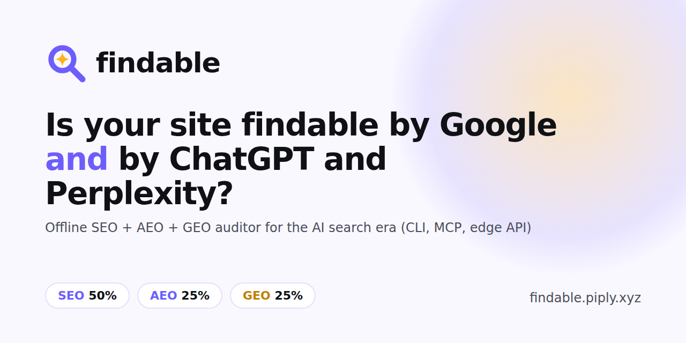
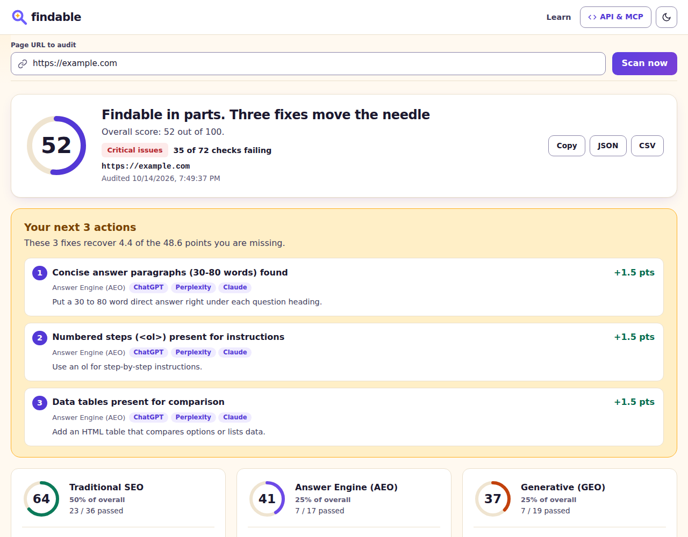

<p align="center"></p>

# Is your site findable by Google AND by ChatGPT/Perplexity?

**findable: SEO + AEO + GEO auditor for the AI search era (CLI, MCP, edge API).** Scores summarise findable's own checks; they do not measure Google rankings or AI citations.

[](https://github.com/findable-page/findable/actions/workflows/ci.yml)
[](https://goreportcard.com/report/github.com/findable-page/findable)
[](https://github.com/findable-page/findable/releases)
[](LICENSE)

**Live demo: https://findable.page** · **Learn: https://findable.page/learn** · [The build story](docs/STORY.md)



## Why

AI answer engines now sit between your page and your reader. They tend to quote short, structured, attributed passages. A page can rank well on Google and still not be cited in a ChatGPT or Perplexity answer.

findable checks the signals answer engines are documented or commonly reported to use: whether a machine can lift a clean answer out of the page (AEO), and whether the page carries trust signals a generative engine may use to cite it (GEO), alongside classic SEO. It is written in Go with no account and no quota. Scoring a local HTML file is fully offline; URL, crawl and site checks make network requests, and the hosted API exists if you prefer not to run it yourself.

## Scoring model

One overall score from 0 to 100, built from three families:

| Family | Weight | Page checks | What it measures |
|---|---|---|---|
| SEO | 50% | 98 | Title and meta tags, headings, canonical, Open Graph and Twitter cards, mobile, HTTPS and security headers, accessibility landmarks |
| AEO (answer engine optimization) | 25% | 35 | Structured data, FAQ markup, short direct answers, question headings, lists, tables, steps, readability |
| GEO (generative engine optimization) | 25% | 27 | Author and organization markup, dates, citations and quotes, passage-ready blocks, trust links, no snippet blocking |

The Go engine runs 165 page checks; the edge API runs a separate port. Seventeen site checks are opt-in (`-site`) and unscored: robots.txt present, the page allowed for `*`, four AI search crawlers (OAI-SearchBot, PerplexityBot, Claude-SearchBot, Googlebot), five AI training crawlers (GPTBot, ClaudeBot, Google-Extended, Applebot-Extended, meta-externalagent), and `/llms.txt` present. Every failing check names what to fix.

## Quickstart

```bash
go install github.com/findable-page/findable/cmd/findable@latest   # Go 1.26+
```

Homebrew: planned for first release; use go install.

Then:

```bash
findable https://example.com
findable ./page.html          # local file, no server needed
```

It prints scores and a prioritized fix list (severity × evidence tier), and saves a report file in `-o` (default `.`). Scores are weighted; `llms.txt` is optional hygiene, not a documented ranking signal.

## CLI

```
findable [audit] [-o dir] [-format csv|json|sarif] [-fail-under N] [-q] [-k keyphrase]
         [-site] [-crawl] [-sitemap url] [-limit N] [-allow-private] <url or file>
findable bots [-bots OAI-SearchBot,PerplexityBot] [-path /] [-format text|json] <url>
findable mcp
findable serve 127.0.0.1:8080
```

| Flag | Meaning |
|---|---|
| `-format csv\|json\|sarif` | Report format. `json` is the same object `/api/scan` returns, `sarif` is SARIF 2.1.0 for GitHub code scanning. Default `csv`. |
| `-fail-under N` | Exit 1 and name every page whose overall score is below N. |
| `-sitemap URL` | Audit the pages a sitemap lists. Sitemap indexes are followed. |
| `-site` | Also run the 17 site checks (robots.txt, AI search crawlers, AI training crawlers, llms.txt). |
| `-crawl` | Follow internal links, up to `-limit` pages (default 20). |
| `-k` | Focus keyphrase. The Go engine runs the four keyphrase checks. |
| `-top N`, `-min-severity LEVEL` | Limit the terminal fix list (critical, high, medium, low). |
| `-config path` | Load strict JSON config; defaults to `findable.json` if present. Gate, crawl, bots, baseline and ignore sections currently return a usage error rather than silently doing nothing. |
| `-o`, `-q` | Report directory; `-q` hides the failing-check list. |
| `-serve 127.0.0.1:8080` | Legacy flag (or `findable serve`); local API and web UI. Bind to localhost; `:8080` listens on every interface. |
| `-mcp` | Legacy flag (or `findable mcp`); MCP server over stdio. |
| `-allow-private` | Allow localhost and private-network targets. Without it every fetch, including crawl and sitemap links and MCP, refuses non-public hosts, ignores `HTTPS_PROXY`/`HTTP_PROXY`, and only connects to ports 80 and 443. With it the CLI uses a plain HTTP client: no address guard, any port, proxy variables honoured. `-serve` is always guarded and ignores this flag. |

```bash
findable -q -format sarif -fail-under 70 https://example.com
findable -sitemap https://example.com/sitemap.xml -limit 50
findable -site -crawl -limit 10 https://example.com
findable bots -bots OAI-SearchBot,Claude-SearchBot https://example.com
```

Bot probes use spoofed user agents from **your IP**, not vendor IP ranges. A WAF may treat the real bot differently. `0` means success, `1` means score gate failed, `2` means invalid usage, `3` means runtime/network or report-write error.

## MCP for agents

Add to Claude Desktop, Cursor or Windsurf:

```json
{ "mcpServers": { "findable": { "command": "findable", "args": ["-mcp"] } } }
```

No Go toolchain? Build the MCP server from source: `(cd mcp && bun install && bun run build)`, then use `{ "command": "node", "args": ["/path/to/findable/mcp/dist/index.js"] }`.

Tools: `audit_page` (URL or file), `audit_html_content` (raw HTML, no network), `crawl_site`, `generate_csv_report`. Prompt: `seo_audit_prompt`.

## API

Hosted at https://findable.page (source: [findable-page/findable-page](https://github.com/findable-page/findable-page)), or run your own local server with `findable -serve 127.0.0.1:8080`.

```bash
curl -s -X POST https://findable.page/api/scan \
  -H "Content-Type: application/json" \
  -d '{"url":"https://example.com","keyphrase":"example","site":true}'
```

`/api/scan` only fetches public hosts: ports 80 and 443, 5 redirects, 10 seconds, 5 MB, rate limited. See [SECURITY.md](SECURITY.md).

## GitHub Action

```yaml
permissions:
  security-events: write
steps:
  - uses: findable-page/findable@v0.2.0
    with:
      url: https://example.com
      fail-under: 70
      args: -site
```

The action builds the CLI, uploads failing checks to code scanning as SARIF, then fails the job below `fail-under`.

## Development

```bash
git clone https://github.com/findable-page/findable && cd findable
(cd mcp && bun install)
make test
```

See [CONTRIBUTING.md](CONTRIBUTING.md) and [CHANGELOG.md](CHANGELOG.md). `testdata/` holds sample pages.

## License

MIT
