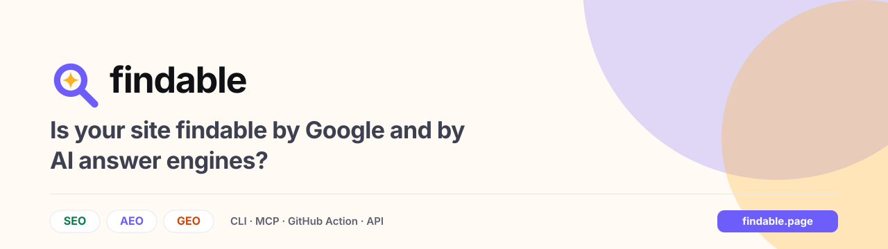
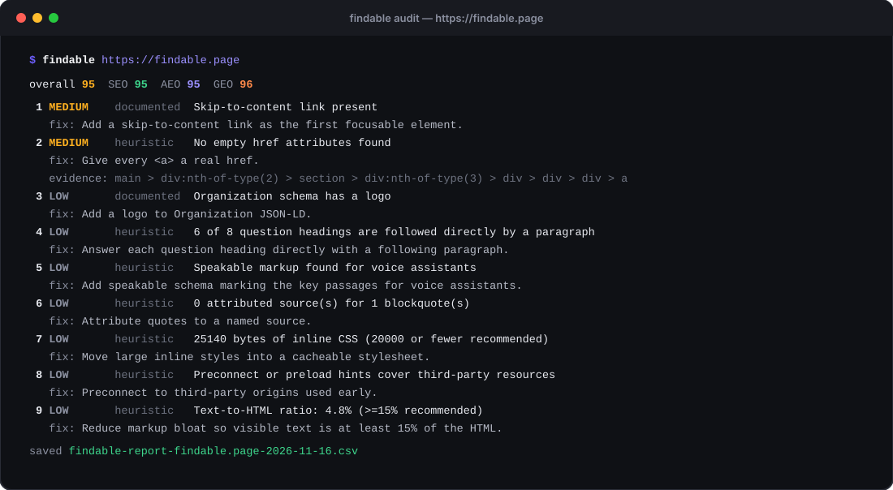

<p align="center">
  <picture>
    <source media="(prefers-color-scheme: dark)" srcset="docs/images/banner-dark.svg">
    
  </picture>
</p>

# Is your site findable by Google AND by ChatGPT/Perplexity?

**findable** is an SEO + AEO + GEO auditor for the AI search era (CLI, MCP, GitHub Action, edge API). Scores summarise findable's own checks; they do not measure Google rankings or AI citations.

[](https://github.com/findable-page/findable/actions/workflows/ci.yml)
[](https://goreportcard.com/report/github.com/findable-page/findable)
[](https://github.com/findable-page/findable/releases)
[](https://www.npmjs.com/package/findable)
[](LICENSE)

**Live demo: [findable.page](https://findable.page)** · **Learn: [findable.page/learn](https://findable.page/learn)** · [The build story](docs/STORY.md)

## Quick start

```bash
go install github.com/findable-page/findable/cmd/findable@latest   # Go 1.26+

findable https://example.com
findable ./page.html          # local file, no server needed
```

It prints scores and a prioritized fix list (severity × evidence tier), and writes a report in `-o` (default `.`). Homebrew is not available yet.

<p align="center">
  
</p>

<p align="center"><sub>A real audit of https://findable.page on 16 November 2026. Scores are findable's own checks, not rankings or citations.</sub></p>

## Why

AI answer engines now sit between your page and your reader. They tend to quote short, structured, attributed passages. A page can rank well on Google and still not be cited in a ChatGPT or Perplexity answer.

findable checks the signals answer engines are documented or commonly reported to use: whether a machine can lift a clean answer out of the page (AEO), and whether the page carries trust signals a generative engine may use to cite it (GEO), alongside classic SEO. It is written in Go with no account and no quota. Scoring a local HTML file is fully offline; URL, crawl and site checks make network requests, and the hosted API exists if you prefer not to run it yourself.

## Scoring model

One overall score from 0 to 100, built from three families. The default model is weighted by severity × evidence tier; use `-score-model flat` for the legacy passed/total scores (the GitHub Action still defaults to `flat` so existing gates do not move).

| Family | Weight | Page checks | What it measures |
|---|---|---|---|
| SEO | 50% | 100 | Title and meta tags, headings, canonical, Open Graph and Twitter cards, mobile, HTTPS and security headers, accessibility landmarks |
| AEO (answer engine optimization) | 25% | 38 | Structured data, FAQ markup, short direct answers, question headings, lists, tables, steps, readability |
| GEO (generative engine optimization) | 25% | 31 | Author and organization markup, knowsAbout topics, author credentials, dates, citations and quotes, passage-ready blocks, trust links, no snippet blocking |

The Go engine runs 169 page checks. Four more SEO checks run when you pass a focus keyphrase with `-k`. The hosted API at [findable.page](https://findable.page) is a separate TypeScript engine. Eighteen site checks are opt-in (`-site`) and unscored. Every failing check names what to fix. `llms.txt` is optional hygiene, not a documented ranking signal.

<details>
<summary>The 18 site checks (<code>-site</code>)</summary>

- `robots.txt` is present, and the page is allowed for `*`
- AI search crawlers: OAI-SearchBot, PerplexityBot, Claude-SearchBot, Googlebot, Bingbot
- On-demand user-fetch crawlers: ChatGPT-User, Perplexity-User, Claude-User
- AI training crawlers: GPTBot, ClaudeBot, Google-Extended, Applebot-Extended, meta-externalagent, CCBot
- `/llms.txt` is present, and when it is, its structure matches the llmstxt.org format (`llms-txt-spec`)

Blocking a training crawler does not affect AI search citations. `Google-Extended` governs Gemini training, not AI Overviews.

</details>

## CLI

```
findable [audit] [-o dir] [-format csv|json|sarif] [-fail-under N] [-score-model weighted|flat]
         [-q] [-k keyphrase] [-site] [-crawl] [-sitemap url] [-limit N] [-top N]
         [-min-severity LEVEL] [-config path] [-allow-private] <url or file>
findable bots [-bots OAI-SearchBot,PerplexityBot] [-path /] [-format text|json] <url>
findable diff [-fail-on-regression] [-max-drop N] [-markdown] <baseline.json> <current.json>
findable mcp
findable serve 127.0.0.1:8080
```

| Flag | Meaning |
|---|---|
| `-format csv\|json\|sarif` | Report format. `json` is the same object `/api/scan` returns, `sarif` is SARIF 2.1.0 for GitHub code scanning. Default `csv`. |
| `-fail-under N` | Exit 1 and name every page whose overall score is below N. |
| `-score-model weighted\|flat` | Scoring formula. Default `weighted`. `flat` keeps legacy passed/total scores. |
| `diff` | Compare a JSON report against a stored baseline: per-page score movement (overall, SEO, AEO, GEO), checks that stopped passing, and improvements. Accepts page, crawl and sitemap JSON reports; `-markdown` prints a PR-comment table, `-fail-on-regression` exits 1 when any check regressed or a page's overall score dropped by more than `-max-drop` (default 0). |
| `-sitemap URL` | Audit the pages a sitemap lists. Sitemap indexes are followed. |
| `-site` | Also run the 18 site checks (robots.txt, AI search, user-fetch and training crawlers, llms.txt). |
| `-crawl` | Follow internal links, up to `-limit` pages (default 20). |
| `-k` | Focus keyphrase. Adds the four keyphrase checks (title, description, H1, body). |
| `-top N`, `-min-severity LEVEL` | Limit the terminal fix list (default 10 items; levels are critical, high, medium, low). |
| `-config path` | Load strict JSON config; defaults to `findable.json` if present. Gate, crawl, bots, baseline and ignore sections currently return a usage error rather than silently doing nothing. |
| `-o`, `-q` | Report directory (default `.`); `-q` hides the failing-check list. |
| `-serve 127.0.0.1:8080` | Legacy flag (or `findable serve`); local API and web UI. Bind to localhost; `:8080` listens on every interface. |
| `-mcp` | Legacy flag (or `findable mcp`); MCP server over stdio. |
| `-allow-private` | Allow localhost and private-network targets. Without it every fetch, including crawl and sitemap links and MCP, refuses non-public hosts, ignores `HTTPS_PROXY`/`HTTP_PROXY`, and only connects to ports 80 and 443. With it the CLI uses a plain HTTP client: no address guard, any port, proxy variables honoured. `-serve` is always guarded and ignores this flag. |

```bash
findable -q -format sarif -fail-under 70 https://example.com
findable -sitemap https://example.com/sitemap.xml -limit 50
findable -site -crawl -limit 10 https://example.com
findable -q -format json https://example.com -o baseline
findable diff -fail-on-regression baseline.json <current-report>.json
findable bots -bots OAI-SearchBot,Claude-SearchBot https://example.com
```

Bot probes use spoofed user agents from **your IP**, not vendor IP ranges. A WAF may treat the real bot differently. Exit codes: `0` success, `1` score gate failed, `2` invalid usage, `3` runtime/network or report-write error.

## MCP for agents

No Go toolchain? Use the npm package, which calls `https://findable.page/api/scan`:

```json
{ "mcpServers": { "findable": { "command": "npx", "args": ["-y", "findable"] } } }
```

Or run the local Go engine, including file and raw-HTML audits, with no network to the hosted API:

```json
{ "mcpServers": { "findable": { "command": "findable", "args": ["mcp"] } } }
```

The npm server exposes `audit_page`, `crawl_site` and the `seo_audit_prompt` prompt. The Go server adds `audit_html_content` (raw HTML, no network) and `generate_csv_report`. `findable -mcp` is the same as `findable mcp`.

## API

Hosted at https://findable.page, or run your own local server with `findable serve 127.0.0.1:8080`.

```bash
curl -s -X POST https://findable.page/api/scan \
  -H "Content-Type: application/json" \
  -d '{"url":"https://example.com","keyphrase":"example","site":true}'
```

`/api/scan` only fetches public hosts: ports 80 and 443, 5 redirects, 10 seconds, 5 MB, rate limited. See [SECURITY.md](SECURITY.md).

## GitHub Action

```yaml
permissions:
  security-events: write
steps:
  - uses: findable-page/findable@v0.4.0
    with:
      url: https://example.com
      fail-under: 70
      args: -site
```

The action builds the CLI, uploads failing checks to code scanning as SARIF, then fails the job below `fail-under`. Its `score-model` input defaults to `flat` so existing score gates stay put; set `score-model: weighted` to match the CLI default.

## Development

```bash
git clone https://github.com/findable-page/findable && cd findable
(cd mcp && bun install)
make test
```

See [CONTRIBUTING.md](CONTRIBUTING.md) and [CHANGELOG.md](CHANGELOG.md). `testdata/` holds sample pages.

## License

MIT
